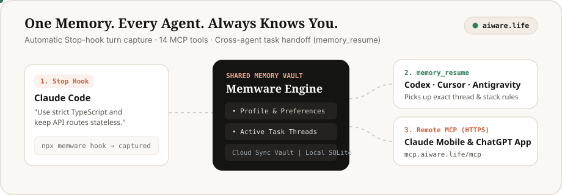

# Memware MCP

<p align="left">
  <a href="https://www.npmjs.com/package/memware"></a>
  <a href="https://github.com/HackSing/memware-mcp/releases"></a>
  <a href="https://aiware.life"></a>
  <a href="https://aiware.life"></a>
</p>

**English** · [简体中文](README.zh-CN.md) · [Official Website & Console (`aiware.life`)](https://aiware.life) · [Documentation](https://aiware.life/docs)

**One Memory. Every Agent. Always Knows You.**

Memware gives **Claude Code**, **Codex**, **Cursor**, **Antigravity**, and **Claude / ChatGPT mobile apps** one shared, durable long-term memory of your preferences, facts, and active engineering threads—with automatic **Stop-hook** capture so persistence never depends on the LLM remembering to call a tool.

<p align="center">
  
</p>

---

## Quickstart (Under 2 Minutes)

### Option A — Memware Cloud (Remote MCP · Zero Local LLM Keys · Desktop + Mobile Sync)

1. Sign in at **[aiware.life/login](https://aiware.life/login)** (GitHub or Google) and copy your `mw_live_...` token from the console.
2. Connect **Claude Code** directly over Streamable HTTP:

```bash
claude mcp add --transport http memware https://mcp.aiware.life/mcp \
  --header "Authorization: Bearer mw_live_..."
```

Or connect via standard `mcp.json` (Cursor, Windsurf, VS Code, Claude Desktop):

```json
{
  "mcpServers": {
    "memware": {
      "url": "https://mcp.aiware.life/mcp",
      "headers": {
        "Authorization": "Bearer mw_live_..."
      }
    }
  }
}
```

Want automatic local **Stop-hook** turn capture synced straight to your Cloud vault (with zero local OpenAI API keys)? Run once:

```bash
npx -y memware@latest login mw_live_...
```

---

### Option B — Memware Local (100% Offline SQLite + Bring Your Own Key)

Run Memware locally on macOS (`darwin-arm64`), Linux (`linux-x64`), or Windows (`windows-x64`) with your own OpenAI-compatible endpoint:

```bash
claude mcp add memware -e MEMWARE_API_KEY="sk-..." -- npx -y memware@latest serve
```

Standard stdio `mcp.json` configuration:

```json
{
  "mcpServers": {
    "memware": {
      "command": "npx",
      "args": ["-y", "memware@latest", "serve"],
      "env": {
        "MEMWARE_API_KEY": "sk-...",
        "MEMWARE_AGENT_ID": "cursor"
      }
    }
  }
}
```

> **Starter Free vs. Local Lifetime**: Local mode is free up to **200 active memories** (reads, searches, updates, and deletes are never locked). Unlock unlimited local memories offline across 3 personal devices with `npx -y memware@latest activate <MW1_LICENSE_KEY>` at **[aiware.life/pricing](https://aiware.life/pricing)**.

---

## Enable Automatic Turn Capture (Stop Hooks)

Read tools let agents *recall* context, while **Stop hooks** capture every completed turn automatically in the background without blocking your terminal:

- **Claude Code (`~/.claude/settings.json`)** — see [`templates/claude-settings-hooks.json`](templates/claude-settings-hooks.json):
  ```json
  {
    "hooks": {
      "Stop": [
        {
          "hooks": [
            {
              "type": "command",
              "command": "npx -y memware@latest hook"
            }
          ]
        }
      ]
    }
  }
  ```
- **Codex CLI (`~/.codex/hooks.json`)** — see [`templates/codex-hooks.json`](templates/codex-hooks.json)
- **Recall Instructions** — drop [`templates/claude-md-snippet.md`](templates/claude-md-snippet.md) into `CLAUDE.md` or [`templates/agents-md-snippet.md`](templates/agents-md-snippet.md) into `AGENTS.md` / `.cursorrules`.

---

## All 14 MCP Memory Tools

Both `https://mcp.aiware.life/mcp` and `npx -y memware@latest serve` expose the exact same 14 MCP tools:

| Tool | Purpose |
| --- | --- |
| `memory_status` | Inspect vault status, active tier, quota usage, and configured model origins. |
| `memory_warmup` | Warm up and initialize the bound user profile idempotently. |
| `memory_get_context` | Assemble budgeted context (`profile` + `active threads` + hybrid semantic recall) for a query. |
| `memory_profile` | Read structured user profile facts, preferences, and standing constraints. |
| `memory_remember` | Explicitly set or overwrite a durable user preference (`field` -> `value`). |
| `memory_threads` | List active unfinished work threads with last-agent provenance and next steps. |
| `memory_process` | Distill and deduplicate durable facts & thread state from a conversation turn. |
| `memory_search` | Hybrid dense-vector + lexical search across stored memories. |
| `memory_list` | Paginate stored memory records newest-first. |
| `memory_update` | Edit an existing memory fact, category, or importance score in place. |
| `memory_delete` | Soft-delete (tombstone) a specific memory record and remove its vectors. |
| `memory_resume` | **Cross-agent task handoff**: generate a ready-to-continue briefing across Claude Code, Codex, and mobile. |
| `memory_archive` | Archive stale low-activity memory clusters. |
| `memory_reset` | Cryptographically fenced physical wipe of all memories, vectors, and threads in the vault. |

---

## Cloud vs. Local Deployment

| Feature | Memware Cloud (`aiware.life`) | Memware Local (`npx memware`) |
| --- | --- | --- |
| **Setup** | Zero LLM keys · 1 URL (`mcp.aiware.life/mcp`) | Local single-file binary + BYOK |
| **Storage** | Isolated Edge Vault + Multilingual Vector Index | `~/.memware` local SQLite + vectors |
| **Multi-Device & Mobile** | Yes (Claude iOS/Android, ChatGPT App, Desktop) | Single machine |
| **Visual Web Console** | Yes (`aiware.life/app/memories`) | Local CLI / HTTP loopback |
| **Pricing** | Free Starter · Pro `$12/mo` (`$99/yr`) · Max `$29/mo` | Free up to 200 memories · `$49` Founding Lifetime |

---

## Downloads & Support

- **Web Console & Pricing**: [https://aiware.life](https://aiware.life)
- **Prebuilt Binaries (`darwin-arm64`, `linux-x64`, `windows-x64`)**: [GitHub Releases](https://github.com/HackSing/memware-mcp/releases)
- **Bug Reports & Feature Requests**: [GitHub Issues](https://github.com/HackSing/memware-mcp/issues/new/choose)
- **Community Discussions**: [GitHub Discussions](https://github.com/HackSing/memware-mcp/discussions)
- **Security Policy**: [SECURITY.md](SECURITY.md)

Copyright (c) 2026 Memware ([aiware.life](https://aiware.life)). Commercial software — see `LICENSE` inside distributed packages.
