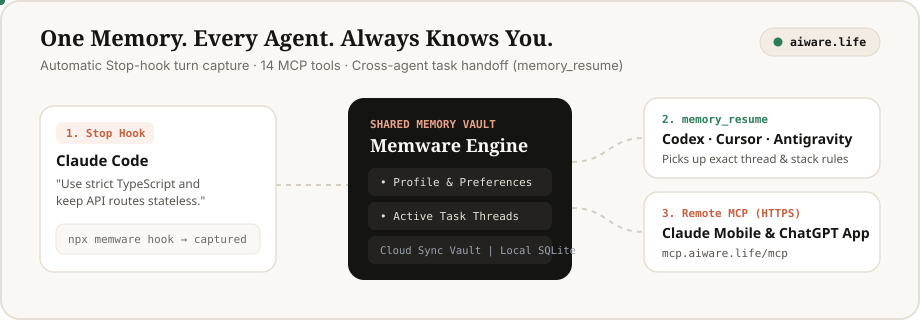

# Memware MCP（跨 Agent 共享长期记忆）

<p align="left">
  <a href="https://www.npmjs.com/package/memware"></a>
  <a href="https://github.com/HackSing/memware-mcp/releases"></a>
  <a href="https://aiware.life/zh"></a>
  <a href="https://aiware.life/zh"></a>
</p>

[English](README.md) · **简体中文** · [中文官网与可视化记忆控制台 (`aiware.life/zh`)](https://aiware.life/zh) · [接入文档](https://aiware.life/zh/docs)

**一份记忆，所有 Agent 通用，随时随地懂你。**

Memware 为 **Claude Code**、**Codex**、**Cursor**、**Antigravity** 以及 **Claude / ChatGPT 手机端 App** 提供统一、持久的个人长期记忆与跨工具任务接力（`memory_resume`）。依托原生 **Stop Hook** 自动捕获已完成对话轮次，无需依赖大模型“自觉记得”调用写入工具。

<p align="center">
  
</p>

---

## 2 分钟快速接入

### 方案 A — Memware Cloud（远程 MCP · 免配大模型 Key · 桌面与手机实时同步）

1. 登录 **[aiware.life/login](https://aiware.life/login)**（支持 GitHub / Google 一键登录），在控制台复制你的 `mw_live_...` 令牌。
2. 一行命令挂载远程 Streamable HTTP MCP：

```bash
claude mcp add --transport http memware https://mcp.aiware.life/mcp \
  --header "Authorization: Bearer mw_live_..."
```

如果还希望本地 Claude Code / Codex 的 **Stop Hook** 免配 OpenAI Key 自动同步到云端记忆舱，只需执行一次：

```bash
npx -y memware@latest login mw_live_...
```

---

### 方案 B — Memware Local（100% 本地离线 SQLite + 自备 API Key）

支持 macOS（`darwin-arm64`）、Linux（`linux-x64`）与 Windows（`windows-x64`）单文件预编译二进制：

```bash
claude mcp add memware -e MEMWARE_API_KEY="sk-..." -- npx -y memware@latest serve
```

> **免费版与一次买断版**：本地模式前 **200 条活跃记忆永久免费**（超限仅暂停自动新增，读取、搜索、编辑与删除永不锁死）。前往 **[aiware.life/zh/pricing](https://aiware.life/zh/pricing)** 获取离线 Ed25519 激活码（`MW1...`），执行 `npx -y memware@latest activate <KEY>` 即可离线解锁最多 3 台个人设备无限本地容量。

---

## 模板与资源链接

- [`templates/claude-settings-hooks.json`](templates/claude-settings-hooks.json) — Claude Code 自动捕获 Stop Hook 配置
- [`templates/codex-hooks.json`](templates/codex-hooks.json) — Codex CLI 自动捕获 Stop Hook 配置
- [`templates/claude-md-snippet.md`](templates/claude-md-snippet.md) — `CLAUDE.md` 记忆按需召回指令模板
- [`templates/agents-md-snippet.md`](templates/agents-md-snippet.md) — `AGENTS.md` / `.cursorrules` 跨端接力模板
- **问题反馈**：[GitHub Issues](https://github.com/HackSing/memware-mcp/issues/new/choose) · [Discussions](https://github.com/HackSing/memware-mcp/discussions)

Copyright (c) 2026 Memware ([aiware.life](https://aiware.life)). All rights reserved.
